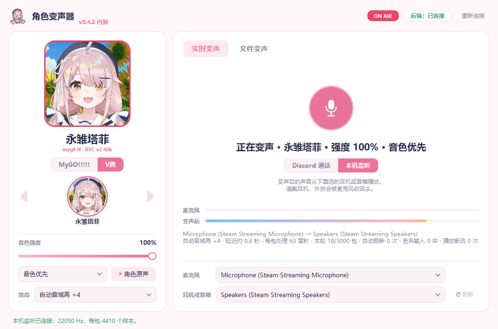
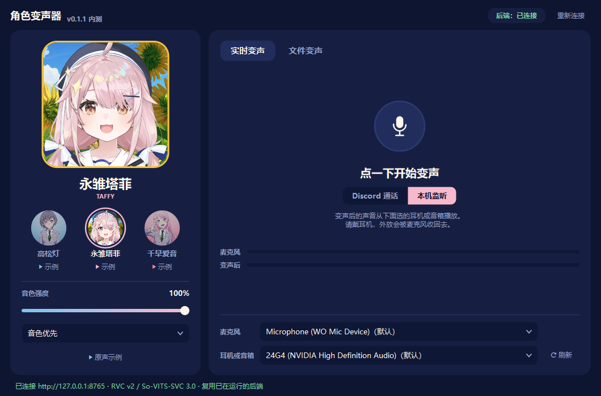

# character-voice-changer

A local, real-time voice changer for Windows that turns your microphone into an anime character's voice and sends it to Discord.

Pick Tomori Takamatsu, Ace Taffy or Anon Chihaya, speak normally, and the app converts your speech in 200 ms packets on your own GPU. It can also convert recorded or imported audio files. Nothing leaves the machine.

## Key Features

- Three dedicated RVC v2 40k voices, with matched retrieval indexes and RMVPE pitch extraction
- Install user-supplied `.pth` / `.index` pairs with checksum verification and a one-second inference check
- Real-time conversion over a local WebSocket, about 1 s to the local virtual microphone on the tested setup
- Discord output through a virtual microphone (Steam Streaming Microphone or VB-CABLE), or local monitoring
- Streaming noise suppression (GTCRN) and voice activity detection (Silero VAD), silent during pauses
- File mode: record or import WAV / FLAC / MP3 / OGG, compare original and result, save as WAV
- Desktop GUI that starts and stops the backend by itself
- Objective evaluation tools: character error rate, speaker similarity and packet-join energy
- Original character recordings and converted previews available directly in the GUI
- Versioned releases with a changelog; current internal beta is 0.2.0

## Tech Stack

- Python 3.13
- FastAPI and Uvicorn (HTTP and WebSocket backend)
- ONNX Runtime with DirectML
- Optional experimental Seed-VC runtime, disabled by default
- RVC v2, So-VITS-SVC 3.0, OpenVoice V2, ContentVec, HuBERT-Soft
- GTCRN, Silero VAD, RMVPE, Praat (parselmouth), FAISS
- PySide6 (Qt 6), sounddevice (PortAudio), soxr

## Screenshots

All images are captures of the running app on Windows 11, taken while the self-check drove it against the real backend.

<table>
  <tr>
    <td colspan="2" align="center">
      
      <br />
      <sub>
        <strong>EN:</strong> Real-time conversion running. The avatar frame turns red, both level bars move, and the status line shows the devices, delay and per-packet processing time.<br />
        <strong>中文：</strong> 实时变声进行中。头像描边变红，两条电平条在动，状态行显示设备、延迟和每包处理时间。
      </sub>
    </td>
  </tr>
  <tr>
    <td width="50%" align="center">
      
      <br />
      <sub>
        <strong>EN:</strong> Main window. Character and strength on the left, one large switch on the right, devices at the bottom.<br />
        <strong>中文：</strong> 主窗口。左边选角色和强度，右边一个大开关，底部选设备。
      </sub>
    </td>
    <td width="50%" align="center">
      
      <br />
      <sub>
        <strong>EN:</strong> File mode after a conversion. The result is tagged with the input, character and strength that produced it.<br />
        <strong>中文：</strong> 文件变声完成后。结果标着生成它的输入、角色和强度。
      </sub>
    </td>
  </tr>
  <tr>
    <td width="50%" align="center">
      
      <br />
      <sub>
        <strong>EN:</strong> Tomori selected. The frame, caption and switch take the character's colour.<br />
        <strong>中文：</strong> 选中高松灯。描边、标注和开关换成角色色。
      </sub>
    </td>
    <td width="50%" align="center">
      
      <br />
      <sub>
        <strong>EN:</strong> Anon selected.<br />
        <strong>中文：</strong> 选中千早爱音。
      </sub>
    </td>
  </tr>
</table>

## Chinese Notes / 中文说明

一个在本机运行的角色变声器。选择高松灯、永雏塔菲或千早爱音，对着麦克风说话，变声后的声音发给 Discord，也可以转换录音和音频文件。

## Latest 安装说明

当前版本：`0.2.0`（内测版）

需要 Windows 10 或 11、Python 3.13 和 Git。默认后端是 ONNX / DirectML 的 RVC v2，本机验证为 RTX 5060 Ti 16 GB。常规运行不需要额外的 CUDA / PyTorch 环境。

1. 克隆仓库，双击 `start-gui.cmd`。
2. 首次启动会建立虚拟环境并安装依赖。已安装三套本地角色模型时，只准备 ContentVec、RMVPE、GTCRN 和 VAD 等必要推理图。没有本地模型时会准备原来的兼容声线（约 2 GB 权重及导出环境）；这与本次导入的新声线有区别。权重均校验 SHA-256。
3. 窗口右上角显示“后端：已连接”后即可使用。之后可以离线运行。

三位角色都可以切换处理方式。新 RVC 模型的默认“音色优先”采用 0.75 检索比例、0.33 清音特征混合；“通话清晰”将检索比例降到最多 0.5，清音混合比例降到最多 0.15，以保留更多原始发音特征。两档均使用 RMVPE，不再串接 OpenVoice 或混回输入者的有声波形。头像下会显示实际模型名，避免把兼容声线误认为已安装的新模型。

本机已导入的模型如下，清单与 SHA-256 见 [安装记录](notes/installed-rvc-models.json)：

| 角色 | 实际权重 | 来源 |
| --- | --- | --- |
| 高松灯 | `deng.pth` / 40k RVC v2 | 用户提供的教程模型与配套索引 |
| 永雏塔菲 | `mygf-tf.pth` / 40k RVC v2 | 用户提供的 `Ai塔菲.zip` |
| 千早爱音 | `Anon_v2.pth` / 40k RVC v2 | Wanlau 的 BanG Dream 对白模型及配套索引 |

### 导入模型与迁移电脑

大权重不放进 Git。迁移本机这套声线时，把整个 `models/local-rvc/` 文件夹一并复制到新电脑的项目目录；其中的配置使用相对路径，并校验推理图与索引。只克隆源码不会自动获得网盘里的用户模型。

也可以在后端环境已准备好后分别导入自己的权重与索引：

```powershell
.venv\Scripts\python.exe tools\import_rvc.py --voice tomori --checkpoint "D:\模型\deng.pth" --index "D:\模型\deng.index" --target-hz 320
.venv\Scripts\python.exe tools\import_rvc.py --voice taffy --checkpoint "D:\模型\mygf-tf.pth" --index "D:\模型\taffy.index" --target-hz 429
.venv\Scripts\python.exe tools\import_rvc.py --voice anon --checkpoint "D:\模型\Anon_v2.pth" --index "D:\模型\anon.index" --target-hz 310
```

导入器使用 `torch.load(weights_only=True)`，验证 RVC v2 / f0 架构、已填充的 768 维索引、说话人编号和完整一秒输出，通过后才更新角色配置。导入后重启后端和界面。`--pitch 12` 可使用固定半音移调，默认按目标音域自动调整。`.index` 应与该权重配套，不能把别的角色索引混用。

Seed-VC 作为对照实现保留，需要显式设置 `VOICE_REFERENCE_ENGINE=seed` 才安装并启用；它需要额外 CUDA 环境和约 1.5 GB 权重。它不是本版本默认通话后端。

左栏“角色原声”播放真实配音 / 直播片段，“输入示例”播放测试输入，各角色卡片上的播放按钮播放当前档位的变声示例。参考音出处、片段时间和校验值在 [assets/references/sources.json](assets/references/sources.json)。

想把入口放到任务栏：运行一次 `powershell -NoProfile -ExecutionPolicy Bypass -File make-shortcut.ps1`，右键生成的“角色变声器”快捷方式，在“显示更多选项”里选“固定到任务栏”。

### 在 Discord 里用

1. 在界面底部的“麦克风”里选原声输入。如果用手机，通过 WO Mic 接入时这里选 `Microphone (WO Mic Device)`；WO Mic Client 保持已连接，并取消“设置 → 本地播放”。
2. 选角色，在“实时变声”页选“Discord 通话”，点一下大圆键。
3. 界面会显示 Discord 该选的输入设备名。在 Discord 的“用户设置 → 语音与视频 → 输入设备”里选它。安装 VB-CABLE 后选 `CABLE Output (VB-Audio Virtual Cable)`，Steam 为备用。Discord 的输出设备继续用耳机。
4. 用 Discord 自带的麦克风测试说一句话确认。

WO Mic 是原声输入，Steam 虚拟麦克风是变声输出。Discord 继续选 WO Mic 会绕过变声器。也可以使用 VB-CABLE，不限于 Steam。

如果朋友先听到原声、约一秒后又听到变声，先确认 WO Mic 的“本地播放”已关闭，并检查 Windows 的麦克风“侦听此设备”是否开启。本机这次关闭 WO Mic 本地播放后，朋友确认重复声音消失。软件音色强度保持 100% 时，本地 RVC 路径仅输出转换波形；降低强度会按比例混入原声。变声链路本身仍有约一秒延迟。

项目目录已保存 [VB-CABLE 官方原版安装包与安装说明](third_party/installers/vb-cable/README.md)。软件优先使用 VB-CABLE，Steam 为备用。驱动需要独立以管理员安装并重启；安装器请从纯英文临时目录运行。

## 当前状态

0.2.0 默认使用三套角色专用 RVC，仍属于内测。验证范围和结果见 [本次评测记录](notes/reference-engine-evaluation.md)。

**参考音来源更正：** 0.1.0 / 0.1.1 的灯和爱音参考音来自第三方应用，实际上是 MiMo 合成语音，并非动画原始配音。以前把它们称为“角色日语对白”不准确，相应的相似度数字不能代表与真实角色的相似度。0.2.0 改用动画官方角色 CM 的原始表演并分离配乐，塔菲改用可追溯的直播说话片段，旧引擎的音色向量也已重新生成。

用户已通过真实 Discord 通话确认 VB-CABLE 能传递变声结果，并在关闭 WO Mic 本地播放后确认朋友只听到变声。尚未对该链路系统评测角色相似度或长时间稳定性。自动相似度分数不等于人耳判断。

用户提供的“凑企鹅”视频是演唱目标示例，未核实原始录制方式，不作为已确认的角色原始配音。灯的新默认音域为 320 Hz，目标是贴近用户选定的示例；官方 CM 原声仍单独保留供对照。两种参考不混为一谈。

## 0.1.0 发布说明

- 变声引擎从单一的 OpenVoice 音色转换，换成每位角色专用的模型：高松灯和千早爱音用 RVC v2，永雏塔菲用 So-VITS-SVC 3.0。
- 找到并修掉了“听不清”的主要原因。原来的音色校正对每个一秒窗口单独估计音色，相邻的包被处理得不一样。改用整段会话的音色向量、只校正模型自己的输出之后，16 句测试的字错误率从 16.3% 降到 6.5%。
- 每 200 毫秒一次的包接缝不再有音量下陷。
- 界面重新设计，三位角色都有头像。

完整列表见 [CHANGELOG.md](CHANGELOG.md)。

## 当前文件结构

- `VERSION`，版本号，后端和界面都读它
- `start-gui.cmd`，双击启动界面；后端没有运行时由界面启动
- `start-backend.cmd`，单独启动后端
- `setup_models.py`，按固定版本下载模型并校验，缺少角色模型时调用导出
- `prepare_voices.py`，从固定版本的参考录音重建三个音色向量
- `tools/import_rvc.py`，验证、导出并安装用户 RVC 模型
- `backend/local_rvc.py`，读取本地模型配置并校验文件
- `third_party/rvc/`，RVC 的 MIT 许可证和集成说明
- `setup_reference_engine.py`、`backend/reference_worker.py`，可选的 Seed-VC 对照实现
- `third_party/seed_vc/`，Seed-VC 的 GPL v3 许可证和版本说明
- `make-shortcut.ps1`，生成带头像图标的快捷方式
- `backend/app.py`，HTTP 与 WebSocket 接口
- `backend/engine.py`，音频解码、OpenVoice 音色校正、文件转换入口
- `backend/character.py`，降噪、语音检测、音高跟踪和三位角色的模型推理
- `backend/live.py`，按包渲染、SOLA 对齐和接缝交叉淡化
- `gui/app.py`，主窗口
- `gui/widgets.py`、`gui/theme.py`，自绘控件和配色
- `gui/audio.py`，设备、录音、播放和实时通道的缓冲
- `gui/live.py`，实时变声的工作线程
- `gui/backend.py`，后端客户端和启动器
- `gui/taskbar.py`，任务栏图标归组
- `gui/selfcheck.py`，打开真实窗口跑一遍主要流程
- `tools/export_voices.py`，把 RVC 和 So-VITS-SVC 权重导出成 ONNX
- `tools/eval/`，客观评测脚本
- `voices/`，三个 256 维音色向量
- `assets/`，头像、图标和试听示例
- `notes/`，决策记录和已知问题
- `CHANGELOG.md`，更新日志

`models/` 里的权重和 `.run/` 里的构建缓存不进仓库。

## 目前能做什么

### 实时变声

- 麦克风输入连续重采样到 22,050 Hz，每 200 毫秒送一包
- 输出发往 Discord 用的虚拟麦克风，或从耳机监听
- 说话时切换角色或强度会自动重连
- 停顿时输出静音，不会把底噪变成角色的声音
- 界面显示延迟、每包处理时间、丢弃的输入和播放断流次数

### 文件变声

- 录音，或导入 WAV、FLAC、MP3、OGG，最长 60 秒
- 原声和结果随时切换试听，播放位置保持不变
- 另存为 22,050 Hz 单声道 WAV
- 结果与生成它的输入、角色、强度和处理方式绑定，改了设置就不能把旧结果当成新结果保存

### 界面

- 角色列表来自后端，三位角色都能一键试听示例
- 启动时检查后端，没有运行就启动，关闭窗口时一并停止
- 后端启动失败时显示脚本的退出码和最后几行输出
- 设备被拔出、引擎被占用时给出原因并释放设备

## 当前推理流程

一包音频经过的步骤：

1. GTCRN 连续降噪，Silero VAD 判断是否在说话。
2. RMVPE 跟踪音高，按角色目标音域或固定半音数调整。
3. ContentVec 第 12 层提取 768 维发音特征，检索本角色索引的 8 个近邻，以距离平方的倒数加权。
4. 在特征域保护清辅音，再由本角色的 RVC v2 模型生成波形。100% 强度时不会把说话人的原始有声波形混回来，也不会再经过另一个音色转换模型。
5. 语音门控、SOLA 对齐、分频交叉淡化与最终限幅，再发送有 104 毫秒前瞻的音频。

没有导入本地角色模型时仍可使用原来的兼容声线，界面会显示实际模型名。原兼容路径和可选 Seed-VC 的历史取舍见决策记录。

每一步为什么这样做、试过哪些别的做法，记录在 [notes/decisions.md](notes/decisions.md)。

## 0.1.0 的评测记录

以下为历史结果。灯和爱音的相似度对照音已查明为第三方合成语音，不能用来评价与角色原始配音的接近程度。

在 i5-12400F、RTX 5060 Ti、Windows 11 上测得。

| 项目 | 结果 |
| --- | --- |
| 每 200 毫秒一包的处理时间 | 平均 59 毫秒，95 分位 80 毫秒 |
| 从说话到虚拟麦克风收到声音的延迟 | 0.77 到 0.88 秒 |
| Discord 通话输出的播放断流 | 六次短句测试都是 0 次 |
| 字错误率，干净女声 / 干净男声 / 加噪男声 | 1.3% / 2.0% / 16.3% |
| 说话人相似度，高松灯 / 永雏塔菲 / 千早爱音 | 0.607 / 0.541 / 0.661 |
| 包接缝处的能量 | 0.94 以上（修复前 0.82 到 0.86） |

字错误率和相似度来自 `tools/eval/` 的 16 句合成语音测试集，每个条件每位角色 153 个字。没有做过真人录音和听感测试。

## 接口

后端监听 `http://127.0.0.1:8765`，[接口文档](http://127.0.0.1:8765/docs) 在后端运行时可以打开。

| 请求 | 返回 |
| --- | --- |
| `GET /api/health` | 版本、引擎、推理设备、采样率、最长时长和上传大小上限 |
| `GET /api/voices` | 数组，每条记录包含 `id` 和中文 `name` |
| `POST /api/convert?voice_id=taffy&strength=1` | 请求体直接放音频文件字节。成功返回 `audio/wav`，22,050 Hz 单声道 PCM16 |

`voice_id` 取 `tomori`、`taffy`、`anon`；`strength` 范围 0 到 1。三位角色都支持 `mode=character`（音色优先，默认）和 `mode=call`（通话清晰），文件接口和实时接口使用同一参数。支持 WAV、FLAC、MP3、OGG，单声道或双声道，8 到 96 kHz，0.35 到 60 秒，最多 24 MiB。

错误用 HTTP 状态码和 JSON 的 `detail` 表示。413 是文件过大，422 是音频或参数无效，429 是引擎正忙，500 是推理失败。一次只处理一个转换任务或一个实时会话。

```powershell
curl.exe --fail-with-body "http://127.0.0.1:8765/api/convert?voice_id=taffy&strength=1" -H "Content-Type: audio/wav" --data-binary "@assets/previews/original.wav" -o taffy-test.wav
```

### 实时通道

连接 `ws://127.0.0.1:8765/api/live?voice_id=taffy&strength=1&low_latency=true&speech_context=true`，等待首条 JSON 消息：

```json
{"sample_rate": 22050, "frame_samples": 4410, "format": "s16le", "lookahead_samples": 2304}
```

1. 把采集到的音频连续重采样为 22,050 Hz 单声道，每凑齐 `frame_samples` 个小端 PCM16 样本发一条二进制消息。
2. 每发一包收到一条二进制 PCM16 回包。首包少 `lookahead_samples` 个样本（2,106 个），后续每包 4,410 个，按顺序播放。
3. 正常停止时，把不足一包的输入补零发出，再发文本 `finish`，读回最后 2,304 个样本和关闭帧。中途取消可以直接断开。
4. 关闭码 1013 是引擎正忙，1003 是包长度不对，1001 是超过 30 秒没有收到音频，1008 是来源不被允许。切换角色或强度需要重新连接。

省略 `low_latency` 时每包 8,192 个样本，省略 `speech_context` 时前瞻为 1,024 个样本。

## 评测

```powershell
powershell -NoProfile -ExecutionPolicy Bypass -File tools\eval\make_evalset.ps1 -Sentences tools\eval\sentences.txt -OutDir .run\evalset
powershell -NoProfile -ExecutionPolicy Bypass -File tools\eval\run_config.ps1 -Tag my-change
.venv\Scripts\python.exe tools\eval\join_test.py my-change
```

`run_config.ps1` 在进程内按实时路径渲染测试集，输出字错误率、相似度和耗时，不占用正在运行的后端。识别用的 SenseVoice 模型和 CAM++ 模型需要自己放进 `.run/`，位置见脚本开头；角色参考音使用仓库里的真实录音。`compare_references.py` 可对同一批新旧输出分别计算提示录音和独立片段的相似度。

`.venv-gui\Scripts\python.exe -m gui.selfcheck` 打开真实窗口，把导入、变声、试听、保存、录音、实时变声、角色切换和退出跑一遍。试听会出声。录音和实时变声需要一对虚拟音频线设备提供麦克风信号，找不到时跳过。设备被拔出、引擎被占用和启动脚本失败是模拟的，输出里有注明。

## 声线与素材来源

本项目是爱好者作品，与角色、表演者和权利方没有关联。模型权重不随仓库分发，由 `setup_models.py` 从原发布地址按固定版本下载。

| 项目 | 来源 |
| --- | --- |
| 旧版兼容声线的灯、爱音模型 | TogetsuDo 发布的 RVC v2 权重和 FAISS 索引。[高松灯](https://huggingface.co/TogetsuDo/tomori-rvc) · [千早爱音](https://huggingface.co/TogetsuDo/anon-rvc) |
| 旧版兼容声线的塔菲模型 | NyaruTaffy 32 kHz 的 So-VITS-SVC 3.0 权重，使用配置里的 `taffy` 说话人。[模型与配置](https://huggingface.co/spaces/ZilliaxOfficial/nyaru-svc-3.0/tree/main) |
| 原始参考录音 | [灯官方角色 CM](https://www.youtube.com/watch?v=oo5DW-QZYeo)、[爱音官方角色 CM](https://www.youtube.com/watch?v=7GZ-7YQ-sKk) 分离配乐后的说话片段；[塔菲直播数据集](https://huggingface.co/datasets/KYOU-0/Ace-Taffy-voice)。固定版本、时间段和校验值见 `assets/references/sources.json`。旧第三方合成参考已替换 |
| 本次导入的模型 | 灯与塔菲为用户提供的 `.pth` / `.index`；爱音取自 [Wanlau/RVC_BanGDream](https://huggingface.co/Wanlau/RVC_BanGDream)，使用 bestdori 对白数据训练。权重与索引的固定版本、SHA-256 见安装记录 |
| RVC 后端 | [RVC 官方项目](https://github.com/RVC-Project/Retrieval-based-Voice-Conversion-WebUI)，MIT 许可，固定导出版本与实现说明见 `third_party/rvc/` |
| 可选对照引擎 | [Seed-VC](https://github.com/Plachtaa/seed-vc)，源码与 GPL v3 见 `third_party/seed_vc/`；下载地址与 SHA-256 见 `tools/seed_models.json`。默认不安装、不启动 |
| 高松灯、千早爱音的头像 | 从动画《BanG Dream! It's MyGO!!!!!》官网的角色立绘裁出，版权归原权利方所有。[角色页](https://anime.bang-dream.com/mygo/character/) |
| 永雏塔菲的头像 | 账号的公开头像。[账号主页](https://space.bilibili.com/1265680561) |
| 试听示例 | `assets/previews/original.wav` 是 Windows 中文合成语音，其余三个由本后端转换 |
| 算法与模型 | [RVC](https://github.com/RVC-Project/Retrieval-based-Voice-Conversion-WebUI) · [OpenVoice](https://github.com/myshell-ai/OpenVoice) · [GTCRN](https://github.com/Xiaobin-Rong/gtcrn) · [Silero VAD](https://github.com/snakers4/silero-vad)。各模型的下载地址和校验值在 `setup_models.py` |

请不要用变声结果冒充真人或发布成官方内容。

## 文档约定

有实质性改动时同步更新：

- `VERSION` 和 `CHANGELOG.md`
- `notes/decisions.md`
- `notes/known-issues.md`
- 必要时更新本 README；每次发版重新核对版本号、数字和截图

## 下一步

1. 用用户本人的麦克风录音和真实 Discord 通话校准音域、音色、清晰度与延迟。
2. 扩充跨场景、没有参与训练的原始对白，检查模型的泛化。
3. 对照试听确认默认档位；自动相似度不代替听感。
4. 在其他显卡和没有独立显卡的电脑上测速度。
