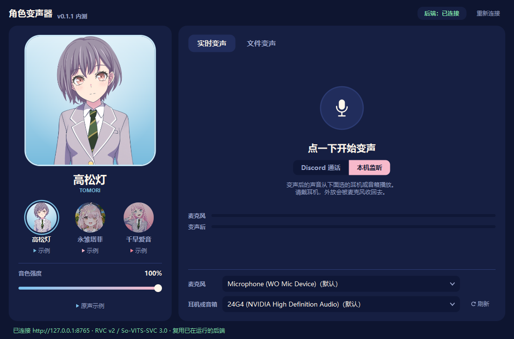

# character-voice-changer

A local, real-time voice changer for Windows that turns your microphone into an anime character's voice and sends it to Discord.

Pick Tomori Takamatsu, Ace Taffy or Anon Chihaya, speak normally, and the app converts your speech in 200 ms packets on your own GPU. It can also convert recorded or imported audio files. Nothing leaves the machine.

## Key Features

- Three character voices: RVC v2 with FAISS retrieval for Tomori and Anon, So-VITS-SVC 3.0 for Taffy
- Real-time conversion over a local WebSocket, about 0.8 s from mouth to listener
- Discord output through a virtual microphone (Steam Streaming Microphone or VB-CABLE), or local monitoring
- Streaming noise suppression (GTCRN) and voice activity detection (Silero VAD), silent during pauses
- File mode: record or import WAV / FLAC / MP3 / OGG, compare original and result, save as WAV
- Desktop GUI that starts and stops the backend by itself
- Objective evaluation tools: character error rate, speaker similarity and packet-join energy
- Taffy presets for character similarity or call clarity, with separate previews and conversion results
- Versioned releases with a changelog; current internal beta is 0.1.1

## Tech Stack

- Python 3.13
- FastAPI and Uvicorn (HTTP and WebSocket backend)
- ONNX Runtime with DirectML
- RVC v2, So-VITS-SVC 3.0, OpenVoice V2, ContentVec, HuBERT-Soft
- GTCRN, Silero VAD, RMVPE, Praat (parselmouth), FAISS
- PySide6 (Qt 6), sounddevice (PortAudio), soxr

## Screenshots

All images are captures of the running app on Windows 11, taken while the self-check drove it against the real backend.

<table>
  <tr>
    <td colspan="2" align="center">
      
      <br />
      <sub>
        <strong>EN:</strong> Real-time conversion running. The avatar frame turns red, both level bars move, and the status line shows the devices, delay and per-packet processing time.<br />
        <strong>中文：</strong> 实时变声进行中。头像描边变红，两条电平条在动，状态行显示设备、延迟和每包处理时间。
      </sub>
    </td>
  </tr>
  <tr>
    <td width="50%" align="center">
      
      <br />
      <sub>
        <strong>EN:</strong> Main window. Character and strength on the left, one large switch on the right, devices at the bottom.<br />
        <strong>中文：</strong> 主窗口。左边选角色和强度，右边一个大开关，底部选设备。
      </sub>
    </td>
    <td width="50%" align="center">
      
      <br />
      <sub>
        <strong>EN:</strong> File mode after a conversion. The result is tagged with the input, character and strength that produced it.<br />
        <strong>中文：</strong> 文件变声完成后。结果标着生成它的输入、角色和强度。
      </sub>
    </td>
  </tr>
  <tr>
    <td width="50%" align="center">
      
      <br />
      <sub>
        <strong>EN:</strong> Tomori selected. The frame, caption and switch take the character's colour.<br />
        <strong>中文：</strong> 选中高松灯。描边、标注和开关换成角色色。
      </sub>
    </td>
    <td width="50%" align="center">
      
      <br />
      <sub>
        <strong>EN:</strong> Anon selected.<br />
        <strong>中文：</strong> 选中千早爱音。
      </sub>
    </td>
  </tr>
</table>

## Chinese Notes / 中文说明

一个在本机运行的角色变声器。选择高松灯、永雏塔菲或千早爱音，对着麦克风说话，变声后的声音发给 Discord，也可以转换录音和音频文件。

## Latest 安装说明

当前版本：`0.1.1`（内测版）

需要 Windows 10 或 11、Python 3.13 和 Git。建议有支持 DirectML 的独立显卡。

1. 克隆仓库，双击 `start-gui.cmd`。
2. 首次启动会建立两个虚拟环境并安装依赖。后端随后下载约 2 GB 的模型和权重，校验 SHA-256，再临时安装 PyTorch 把三个角色导出成 ONNX。这一步需要联网，耗时取决于网速，导出产物与构建环境也需要磁盘空间。
3. 窗口右上角显示“后端：已连接”后即可使用。之后可以离线运行。

选中塔菲时，强度滑块下方可以选择“音色优先”或“通话清晰”。默认“音色优先”减少说话人原声的混入，改用 RMVPE 提取音高。背景噪声较大时，“通话清晰”能保留更多发音细节。两档的“示例”按钮播放各自的转换结果。

想把入口放到任务栏：运行一次 `powershell -NoProfile -ExecutionPolicy Bypass -File make-shortcut.ps1`，右键生成的“角色变声器”快捷方式，在“显示更多选项”里选“固定到任务栏”。

### 在 Discord 里用

1. 在界面底部的“麦克风”里选你平时说话的设备。
2. 选角色，在“实时变声”页选“Discord 通话”，点一下大圆键。
3. 界面会显示 Discord 该选的输入设备名。在 Discord 的“用户设置 → 语音与视频 → 输入设备”里选它。本机验证过的是 `Microphone (Steam Streaming Microphone)`。Discord 的输出设备继续用耳机。
4. 用 Discord 自带的麦克风测试说一句话确认。

没有成对的虚拟音频设备时，界面会提示安装 [VB-CABLE](https://vb-audio.com/Cable/index.htm) 后刷新设备。

## 当前状态

0.1.1 继续调整塔菲音色，仍属于内测。

- 三位角色都能实时变声和转换文件，自检 62 项全部通过。
- 塔菲“音色优先”的 CAM++ 均值为 0.618，本次重测的 0.1.0 为 0.533。干净女声和男声的字错误率均为 3.3%，10 dB 加噪男声为 26.8%。
- 塔菲“通话清晰”的 CAM++ 均值为 0.529，加噪男声字错误率为 19.6%。两个档位的取舍和完整数据记录在 CHANGELOG。
- 还没有在真实的 Discord 通话里由另一个人确认过听感。

## 0.1.0 发布说明

- 变声引擎从单一的 OpenVoice 音色转换，换成每位角色专用的模型：高松灯和千早爱音用 RVC v2，永雏塔菲用 So-VITS-SVC 3.0。
- 找到并修掉了“听不清”的主要原因。原来的音色校正对每个一秒窗口单独估计音色，相邻的包被处理得不一样。改用整段会话的音色向量、只校正模型自己的输出之后，16 句测试的字错误率从 16.3% 降到 6.5%。
- 每 200 毫秒一次的包接缝不再有音量下陷。
- 界面重新设计，三位角色都有头像。

完整列表见 [CHANGELOG.md](CHANGELOG.md)。

## 当前文件结构

- `VERSION`，版本号，后端和界面都读它
- `start-gui.cmd`，双击启动界面；后端没有运行时由界面启动
- `start-backend.cmd`，单独启动后端
- `setup_models.py`，按固定版本下载模型并校验，缺少角色模型时调用导出
- `prepare_voices.py`，从固定版本的参考录音重建三个音色向量
- `make-shortcut.ps1`，生成带头像图标的快捷方式
- `backend/app.py`，HTTP 与 WebSocket 接口
- `backend/engine.py`，音频解码、OpenVoice 音色校正、文件转换入口
- `backend/character.py`，降噪、语音检测、音高跟踪和三位角色的模型推理
- `backend/live.py`，按包渲染、SOLA 对齐和接缝交叉淡化
- `gui/app.py`，主窗口
- `gui/widgets.py`、`gui/theme.py`，自绘控件和配色
- `gui/audio.py`，设备、录音、播放和实时通道的缓冲
- `gui/live.py`，实时变声的工作线程
- `gui/backend.py`，后端客户端和启动器
- `gui/taskbar.py`，任务栏图标归组
- `gui/selfcheck.py`，打开真实窗口跑一遍主要流程
- `tools/export_voices.py`，把 RVC 和 So-VITS-SVC 权重导出成 ONNX
- `tools/eval/`，客观评测脚本
- `voices/`，三个 256 维音色向量
- `assets/`，头像、图标和试听示例
- `notes/`，决策记录和已知问题
- `CHANGELOG.md`，更新日志

`models/` 里的权重和 `.run/` 里的构建缓存不进仓库。

## 目前能做什么

### 实时变声

- 麦克风输入连续重采样到 22,050 Hz，每 200 毫秒送一包
- 输出发往 Discord 用的虚拟麦克风，或从耳机监听
- 说话时切换角色或强度会自动重连
- 停顿时输出静音，不会把底噪变成角色的声音
- 界面显示延迟、每包处理时间、丢弃的输入和播放断流次数

### 文件变声

- 录音，或导入 WAV、FLAC、MP3、OGG，最长 60 秒
- 原声和结果随时切换试听，播放位置保持不变
- 另存为 22,050 Hz 单声道 WAV
- 结果与生成它的输入、角色、强度和处理方式绑定，改了设置就不能把旧结果当成新结果保存

### 界面

- 角色列表来自后端，三位角色都能一键试听示例
- 启动时检查后端，没有运行就启动，关闭窗口时一并停止
- 后端启动失败时显示脚本的退出码和最后几行输出
- 设备被拔出、引擎被占用时给出原因并释放设备

## 当前稳定方案

一包音频经过的步骤：

1. GTCRN 连续降噪，Silero VAD 判断是否在说话。
2. 跟踪音高，并把说话人的音域移到角色的音域。塔菲“音色优先”使用 RMVPE，其余配置使用 Praat。
3. 提取发音特征：高松灯和千早爱音用 ContentVec 加 FAISS 检索，永雏塔菲用 HuBERT-Soft。
4. 角色模型生成一秒的波形。
5. 高松灯和永雏塔菲再经过 OpenVoice 音色校正，使用整段会话累计的音色向量。
6. 从降噪后的输入补回 1.7 kHz 以上的辅音细节。
7. 取窗口里有 104 毫秒前瞻的那一段，与上一包用 SOLA 对齐后交叉淡化。

每一步为什么这样做、试过哪些别的做法，记录在 [notes/decisions.md](notes/decisions.md)。

## 0.1.0 的评测记录

在 i5-12400F、RTX 5060 Ti、Windows 11 上测得。

| 项目 | 结果 |
| --- | --- |
| 每 200 毫秒一包的处理时间 | 平均 59 毫秒，95 分位 80 毫秒 |
| 从说话到虚拟麦克风收到声音的延迟 | 0.77 到 0.88 秒 |
| Discord 通话输出的播放断流 | 六次短句测试都是 0 次 |
| 字错误率，干净女声 / 干净男声 / 加噪男声 | 1.3% / 2.0% / 16.3% |
| 说话人相似度，高松灯 / 永雏塔菲 / 千早爱音 | 0.607 / 0.541 / 0.661 |
| 包接缝处的能量 | 0.94 以上（修复前 0.82 到 0.86） |

字错误率和相似度来自 `tools/eval/` 的 16 句合成语音测试集，每个条件每位角色 153 个字。没有做过真人录音和听感测试。

## 接口

后端监听 `http://127.0.0.1:8765`，[接口文档](http://127.0.0.1:8765/docs) 在后端运行时可以打开。

| 请求 | 返回 |
| --- | --- |
| `GET /api/health` | 版本、引擎、推理设备、采样率、最长时长和上传大小上限 |
| `GET /api/voices` | 数组，每条记录包含 `id` 和中文 `name` |
| `POST /api/convert?voice_id=taffy&strength=1` | 请求体直接放音频文件字节。成功返回 `audio/wav`，22,050 Hz 单声道 PCM16 |

`voice_id` 取 `tomori`、`taffy`、`anon`；`strength` 范围 0 到 1。塔菲还支持 `mode=character`（音色优先，默认）和 `mode=call`（通话清晰），文件接口和实时接口都使用同一参数。支持 WAV、FLAC、MP3、OGG，单声道或双声道，8 到 96 kHz，0.35 到 60 秒，最多 24 MiB。

错误用 HTTP 状态码和 JSON 的 `detail` 表示。413 是文件过大，422 是音频或参数无效，429 是引擎正忙，500 是推理失败。一次只处理一个转换任务或一个实时会话。

```powershell
curl.exe --fail-with-body "http://127.0.0.1:8765/api/convert?voice_id=taffy&strength=1" -H "Content-Type: audio/wav" --data-binary "@assets/previews/original.wav" -o taffy-test.wav
```

### 实时通道

连接 `ws://127.0.0.1:8765/api/live?voice_id=taffy&strength=1&low_latency=true&speech_context=true`，等待首条 JSON 消息：

```json
{"sample_rate": 22050, "frame_samples": 4410, "format": "s16le", "lookahead_samples": 2304}
```

1. 把采集到的音频连续重采样为 22,050 Hz 单声道，每凑齐 `frame_samples` 个小端 PCM16 样本发一条二进制消息。
2. 每发一包收到一条二进制 PCM16 回包。首包少 `lookahead_samples` 个样本（2,106 个），后续每包 4,410 个，按顺序播放。
3. 正常停止时，把不足一包的输入补零发出，再发文本 `finish`，读回最后 2,304 个样本和关闭帧。中途取消可以直接断开。
4. 关闭码 1013 是引擎正忙，1003 是包长度不对，1001 是超过 30 秒没有收到音频，1008 是来源不被允许。切换角色或强度需要重新连接。

省略 `low_latency` 时每包 8,192 个样本，省略 `speech_context` 时前瞻为 1,024 个样本。

## 评测

```powershell
powershell -NoProfile -ExecutionPolicy Bypass -File tools\eval\make_evalset.ps1 -Sentences tools\eval\sentences.txt -OutDir .run\evalset
powershell -NoProfile -ExecutionPolicy Bypass -File tools\eval\run_config.ps1 -Tag my-change
.venv\Scripts\python.exe tools\eval\join_test.py my-change
```

`run_config.ps1` 在进程内按实时路径渲染测试集，输出字错误率、相似度和耗时，不占用正在运行的后端。`-Settings 'character.TIMBRE_REFINE.taffy=0'` 这样的参数可以临时改 `backend/character.py` 顶部的开关。识别用的 SenseVoice 模型、CAM++ 模型和角色参考音需要自己放进 `.run/`，位置见脚本开头。

`.venv-gui\Scripts\python.exe -m gui.selfcheck` 打开真实窗口，把导入、变声、试听、保存、录音、实时变声、角色切换和退出跑一遍。试听会出声。录音和实时变声需要一对虚拟音频线设备提供麦克风信号，找不到时跳过。设备被拔出、引擎被占用和启动脚本失败是模拟的，输出里有注明。

## 声线与素材来源

本项目是爱好者作品，与角色、表演者和权利方没有关联。模型权重不随仓库分发，由 `setup_models.py` 从原发布地址按固定版本下载。

| 项目 | 来源 |
| --- | --- |
| 高松灯、千早爱音的模型 | TogetsuDo 发布的 RVC v2 权重和 FAISS 索引。[高松灯](https://huggingface.co/TogetsuDo/tomori-rvc) · [千早爱音](https://huggingface.co/TogetsuDo/anon-rvc) |
| 永雏塔菲的模型 | NyaruTaffy 32 kHz 的 So-VITS-SVC 3.0 权重，使用配置里的 `taffy` 说话人。[模型与配置](https://huggingface.co/spaces/ZilliaxOfficial/nyaru-svc-3.0/tree/main) |
| 音色校正用的参考音 | 高松灯和千早爱音取自角色日语对白，永雏塔菲取自直播的说话片段。固定版本和时间段写在 `prepare_voices.py`。[对白](https://github.com/telecom888/Live2dOnAndroid/tree/af08c7b8a0c77444502f27fab0c19e88aeb3c923/app/src/main/assets/voices_builtin) · [直播音频](https://huggingface.co/datasets/KYOU-0/Ace-Taffy-voice) |
| 高松灯、千早爱音的头像 | 从动画《BanG Dream! It's MyGO!!!!!》官网的角色立绘裁出，版权归原权利方所有。[角色页](https://anime.bang-dream.com/mygo/character/) |
| 永雏塔菲的头像 | 账号的公开头像。[账号主页](https://space.bilibili.com/1265680561) |
| 试听示例 | `assets/previews/original.wav` 是 Windows 中文合成语音，其余三个由本后端转换 |
| 算法与模型 | [RVC](https://github.com/RVC-Project/Retrieval-based-Voice-Conversion-WebUI) · [OpenVoice](https://github.com/myshell-ai/OpenVoice) · [GTCRN](https://github.com/Xiaobin-Rong/gtcrn) · [Silero VAD](https://github.com/snakers4/silero-vad)。各模型的下载地址和校验值在 `setup_models.py` |

请不要用变声结果冒充真人或发布成官方内容。

## 文档约定

有实质性改动时同步更新：

- `VERSION` 和 `CHANGELOG.md`
- `notes/decisions.md`
- `notes/known-issues.md`
- 必要时更新本 README；每次发版重新核对版本号、数字和截图

## 下一步

1. 找一个用说话素材训练、来源清楚的塔菲 RVC v2 模型，替换 So-VITS-SVC 3.0 加音色校正的组合。
2. 继续检查音高提取和发音保护对强噪声的影响，RMVPE 已用于塔菲的音色优先档。
3. 用真人麦克风录音和真实的 Discord 通话各验证一次。
4. 在没有独立显卡的电脑上测一次速度。
5. 做一次听感对比，确认客观指标和实际听感一致。
